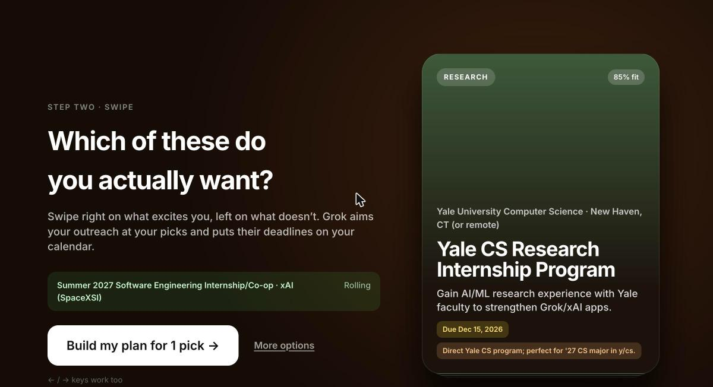
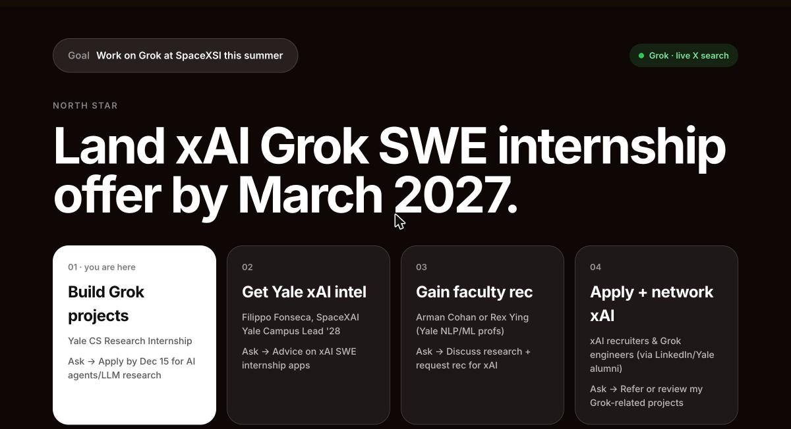

# Bulldog Reach

**Don't network. Get where you're going.**

Bulldog Reach turns a Yale student's goal into a concrete plan, using Grok with live X and web search:

1. **Set a goal.** For example: "Work on Grok at SpaceXSI this summer", "Join a comp-bio lab as a sophomore", "Break into climate VC".
2. **Swipe through real opportunities.** Grok searches for internships, research roles, fellowships, and programs that are open right now, with deadlines and Yale connections. Swipe right on the ones you want and left on the rest.
3. **Get a game plan aimed at your picks:**
   - A **north star**: the concrete outcome you're working toward, with a deadline.
   - A **4-step path**: who to ask, what to ask them for, and why.
   - **People to contact, ranked** by goal fit × reply odds. Each person shows their Yale ties (residential college, clubs, classes, alumni network) and a **hook** taken from a recent X post or article, with a link to the source.
   - **A drafted message for each person**: under 90 words, one specific ask, no filler.
4. **Add it to your calendar.** Follow-up reminders and application deadlines open in Google Calendar, or download everything as a single `.ics` file for Apple Calendar or Outlook.

Built in about 2 hours at the **y/cs × SpaceXSI Grokathon**, Yale, November 17, 2026.






## Beta features (v2)

- **Onboarding:** upload your resume (PDF or Word) and, optionally, LinkedIn's "Save to PDF" export of your profile. Grok turns them into a structured resume you can edit.
- **My list (the "cart"):** swipe right to save an opportunity. Grok then researches its deadlines, info sessions, and office hours, builds an application checklist and draft messages, and ranks your list by urgency.
- **Calendar sync:** a private subscription feed. Subscribe once in Google, Apple, or Outlook Calendar, and every date for opportunities on your list appears automatically.
- **Resume tailoring:** for each opportunity, Grok **suggests** edits (wording, order, keywords, where a number would help). Nothing changes until you accept a suggestion. Grok never invents numbers: it leaves `[X%]` placeholders for you to fill in, and flags any new wording that isn't in your resume. Export to **Word (.docx)** or **PDF**.
- **Yale-only beta:** @yale.edu email sign-in, saved plans, an outreach tracker, and daily usage limits (Supabase).

See [docs/PRD.md](docs/PRD.md) for the product spec and [docs/SOURCES.md](docs/SOURCES.md) for which Yale data sources we can use.

## Why

Yale gives you the network, but nothing helps you use it. LinkedIn tells you who exists. Bulldog Reach tells you **who can actually move your goal forward, what to ask them, and what to say**, using what they posted this week.

## How it works

- **Grok `grok-4.20-0309-non-reasoning`** through the xAI **Responses API** with the server-side `x_search` and `web_search` tools. A typical plan runs 9–11 live searches in about 15–20 seconds.
- `POST /api/opportunities`: goal → 8 real opportunities, each with a URL, deadline, Yale connection, and fit score.
- `POST /api/plan`: goal + your picks (+ optional LinkedIn profiles you paste in) → north star, steps, ranked people, messages, and follow-up timing.
- If live search fails, the server falls back to a plain Grok call. If the whole request fails, the page shows your last good plan instead.
- Deadlines that have already passed are flagged and kept off your calendar.
- Zero dependencies: plain Node `http` and one HTML file.

## Run it

```bash
cp .env.example .env    # add your XAI_API_KEY from console.x.ai
node server.js          # → http://localhost:3000
```

Without a key, the app runs in **demo mode** with sample data.

## Notes

- Reply odds and fit scores are Grok's estimates, not measured response rates.
- Check deadlines and links on the official page before relying on them.
- Profiles are pasted by the user. There's no LinkedIn scraping.

## Team

- David Frumgarzts ([@DavidFrumgarzts](https://github.com/DavidFrumgarzts))
