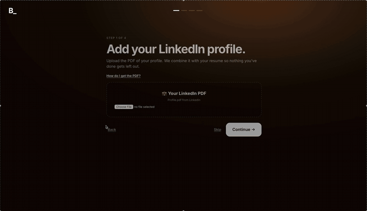
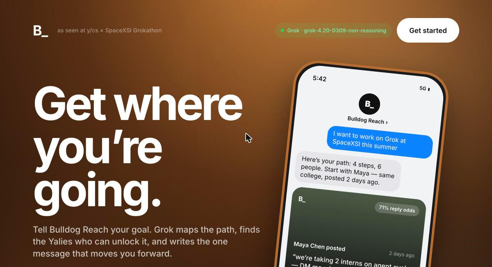
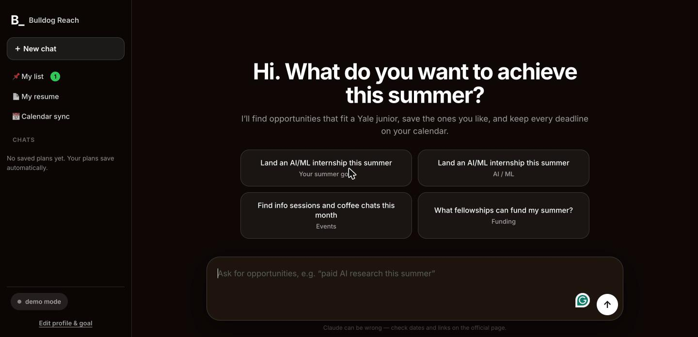
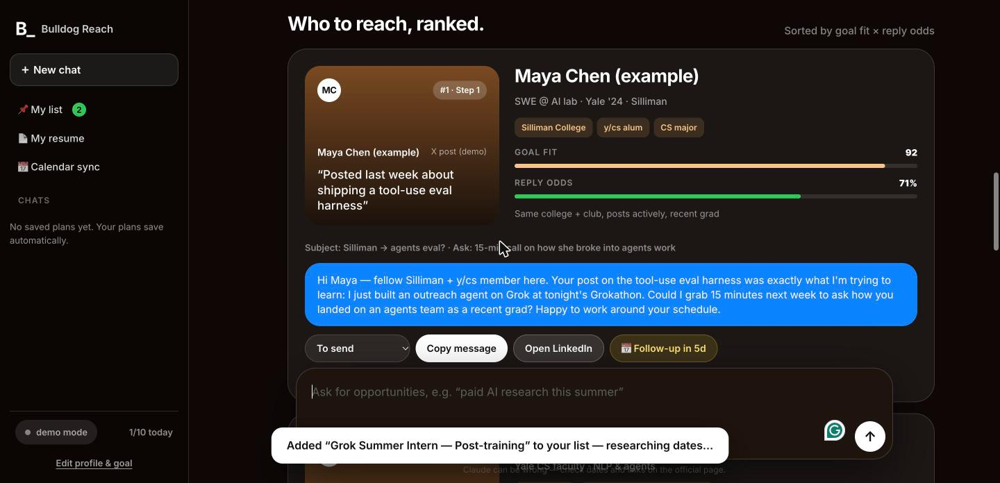
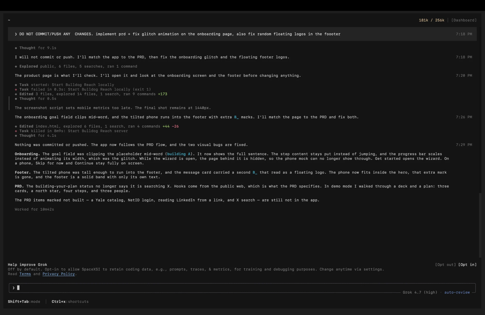
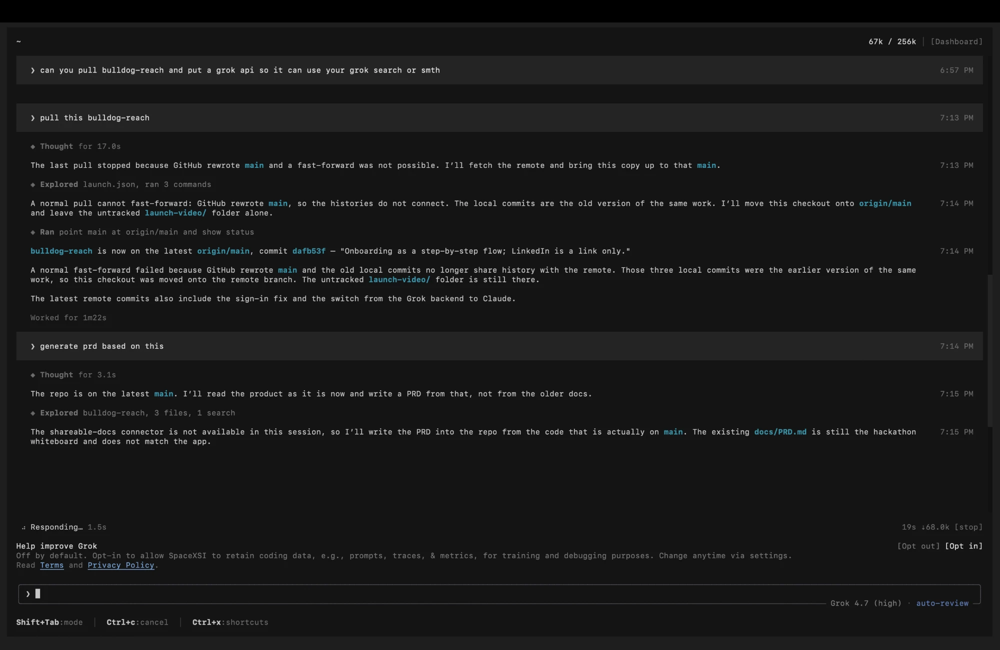
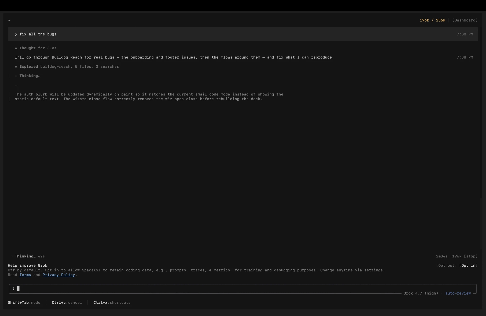

# Bulldog Reach

**Don't network. Get where you're going.**

[](docs/demo.mp4)

▶ **[Watch the full 1-minute demo](docs/demo.mp4)** · Try it live: https://bulldog-reach.onrender.com

Bulldog Reach turns a Yale student's goal into a concrete plan, using Claude with live web search:

1. **Set a goal.** For example: "Work on Grok at SpaceXSI this summer", "Join a comp-bio lab as a sophomore", "Break into climate VC".
2. **Swipe through real opportunities.** Claude searches for internships, research roles, fellowships, and programs that are open right now, with deadlines and Yale connections. Swipe right on the ones you want and left on the rest.
3. **Get a game plan aimed at your picks:**
   - A **north star**: the concrete outcome you're working toward, with a deadline.
   - A **4-step path**: who to ask, what to ask them for, and why.
   - **People to contact, ranked** by goal fit × reply odds. Each person shows their Yale ties (residential college, clubs, classes, alumni network) and a **hook** taken from a recent public post or article, with a link to the source.
   - **A drafted message for each person**: under 90 words, one specific ask, no filler.
4. **Add it to your calendar.** Follow-up reminders and application deadlines open in Google Calendar, or download everything as a single `.ics` file for Apple Calendar or Outlook.

Built in about 2 hours at the **y/cs × SpaceXSI Grokathon**, Yale, November 17, 2026.






## Demo video

The preview at the top plays at 3× speed. Full one-minute walkthrough with sound: [docs/demo.mp4](docs/demo.mp4).

## Built with Grok CLI





## Beta features (v2)

- **Onboarding:** a step-by-step flow asks for your resume (PDF or Word), your LinkedIn profile link, your goal, and a little about you. Claude turns the resume into a structured one you can edit. The LinkedIn link is stored and shown on your resume; the app does not read your LinkedIn profile.
- **My list (the "cart"):** swipe right to save an opportunity. Claude then researches its deadlines, info sessions, and office hours, builds an application checklist and draft messages, and ranks your list by urgency.
- **Calendar sync:** a private subscription feed. Subscribe once in Google, Apple, or Outlook Calendar, and every date for opportunities on your list appears automatically.
- **Resume tailoring:** for each opportunity, Claude **suggests** edits (wording, order, keywords, where a number would help). Nothing changes until you accept a suggestion. Claude never invents numbers: it leaves `[X%]` placeholders for you to fill in, and flags any new wording that isn't in your resume. Export to **Word (.docx)** or **PDF**.
- **Yale-only beta:** @yale.edu email sign-in, saved plans, an outreach tracker, and daily usage limits (Supabase).

See [docs/PRD.md](docs/PRD.md) for the product spec and [docs/SOURCES.md](docs/SOURCES.md) for which Yale data sources we can use.

## Boot Outreach workspace (`/workspace`)

A free, evidence-first job-search workspace built from [the Boot Outreach PRD](docs/BOOT_OUTREACH_PRD.md). Open http://localhost:3000/workspace (or **🧭 Workspace** in the app sidebar).

- **Discover:** searches official employer job boards (public Greenhouse, Lever and Ashby feeds) for ~30 AI, robotics and software companies, plus any board you add. Each role has one canonical URL, a source record and a last-checked time. You can save searches, dismissed roles stay hidden, and "Re-check if open" re-verifies a posting.
- **Evidence:** deadline, term, pay, work mode, sponsorship, work authorization, CPT/OPT and language are quoted from the posting with a link and checked date, or shown as "not stated".
- **Three separate fit answers:** *interest* (your role families, industries, term), *experience* (which requirements your confirmed claims support) and *eligibility* (what the posting says, next to facts you confirmed). It never says "you're eligible".
- **Claims ledger:** the only source for drafts. Statuses are verified, approximate, unreviewed, needs evidence and omit. Corrections and "never use" phrases apply to every new draft.
- **Application workspace:** per-role resume version (with a diff), cover letter, and answers to the employer's questions, all built from claims, with version history. Unsupported numbers, placeholders and approximate claims are flagged and must be fixed or acknowledged before approval.
- **Final review:** a packet preview with a fingerprint. You submit on the employer's site; the app records your approval, the exact packet and any receipt. Nothing is auto-submitted.
- **Contacts & outreach:** import your LinkedIn **Connections.csv** (LinkedIn's own data export), or add people by hand. Email provenance is labeled (verified / from export / you provided / guessed). Drafts must be approved word for word before you can log them as sent. Nothing is sent by the app.
- **Answer library, CSV export, calendar (.ics) of firm dates only, JSON export/import, delete-all.**

It costs nothing to run. Roles are ranked by **meaning**, not keywords, using a small sentence-embedding model (all-MiniLM-L6-v2) that runs on your machine through transformers.js. It downloads once (~23 MB) and needs no key. No paid APIs. Optional integrations are listed in [docs/COSTS.md](docs/COSTS.md). A starter profile drawn from the PRD is in [docs/seed-alwis.json](docs/seed-alwis.json) (Workspace → Your data → Import). Every claim in it starts as *unreviewed*.

## Design

The UI follows one design system, defined in Figma ([Bulldog Reach — Redesign](https://www.figma.com/design/YYfpJf8sfaln8dvonIbWxc)) and mirrored in [`public/theme.css`](public/theme.css). Token names match the Figma variables (for example `Color/bg/app` → `var(--color-bg-app)`). The Figma file has three pages: the design system (tokens, type styles, components), the redesigned screens, and captures of the previous UI for reference.

- **Palette:** Yale-night navy surfaces, one action blue, and highlighter yellow reserved for quoted evidence from job postings.
- **Type:** Schibsted Grotesk throughout; Newsreader italic only for quotes from postings.
- **Shell:** one sidebar for Ask, Discover, Pipeline, Contacts, Answers, Profile and Your data. The original swipe-and-plan chat lives at `/app`.

## Why

Yale gives you the network, but nothing helps you use it. LinkedIn tells you who exists. Bulldog Reach tells you **who can actually move your goal forward, what to ask them, and what to say**, using what they posted this week.

## How it works

- **Claude through the Anthropic Messages API**, two models: **Sonnet 5.5** for features that use the server-side `web_search` tool (capped at 6 searches per request): the opportunity deck, game plan and list research. **Haiku 5.5** (about 20× cheaper) handles resume reading, tailoring and Workspace AI rewrites. Change them with `CLAUDE_MODEL_SEARCH` / `CLAUDE_MODEL_FAST` in `.env`; `REACH_EFFORT` trades speed against thoroughness. The app was first built on Grok at the hackathon; Claude has no X search, so hooks now come from the public web.
- `POST /api/opportunities`: goal → 8 real opportunities, each with a URL, deadline, Yale connection, and fit score.
- `POST /api/plan`: goal + your picks (+ optional LinkedIn profiles you paste in) → north star, steps, ranked people, messages, and follow-up timing.
- If live search fails, the server falls back to a plain Claude call. If the whole request fails, the page shows your last good plan instead.
- Deadlines that have already passed are flagged and kept off your calendar.
- Two dependencies: the Anthropic SDK (paid AI chat, optional) and transformers.js (a free local model the Workspace uses to rank by meaning). Plain Node `http`, no framework.

## Run it

```bash
npm install
cp .env.example .env    # add your ANTHROPIC_API_KEY from platform.claude.com
node server.js          # → http://localhost:3000
```

Without a key, the AI chat is **off** and says so. Nothing is faked. The Workspace (`/workspace`) is fully usable without a key. `DEMO_MODE=1` shows made-up sample data, for UI work only.

## Notes

- Reply odds and fit scores are Claude's estimates, not measured response rates.
- Check deadlines and links on the official page before relying on them.
- Profiles are pasted by the user. There's no LinkedIn scraping.

## Team

- David Frumgarzts ([@DavidFrumgarzts](https://github.com/DavidFrumgarzts))
- Ignacio Montoro Piñeiro (ignacio.montoropineiro@yale.edu)
- Jose Maria Salvador Martinez (josemaria.salvador@yale.edu)
- Alwis Lim (alwis.lim@yale.edu)
